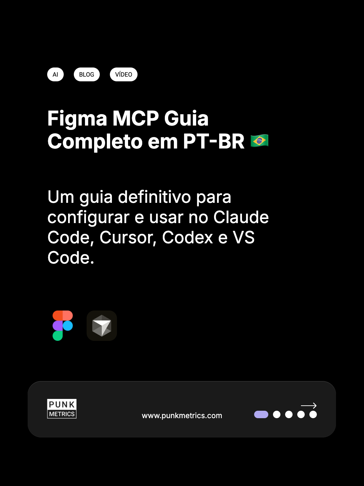
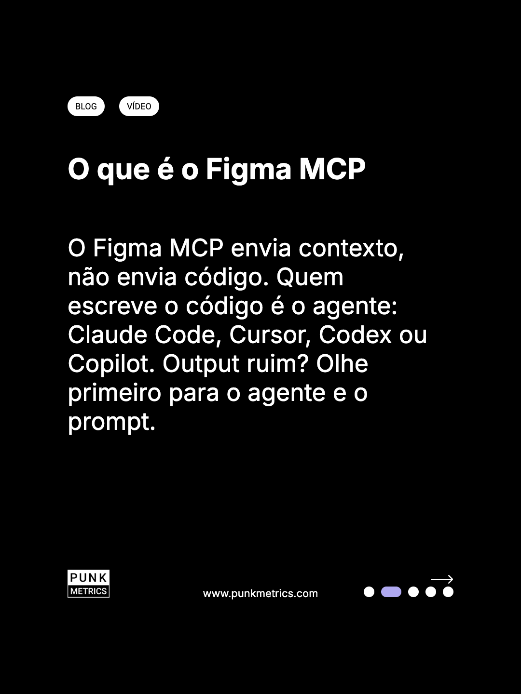
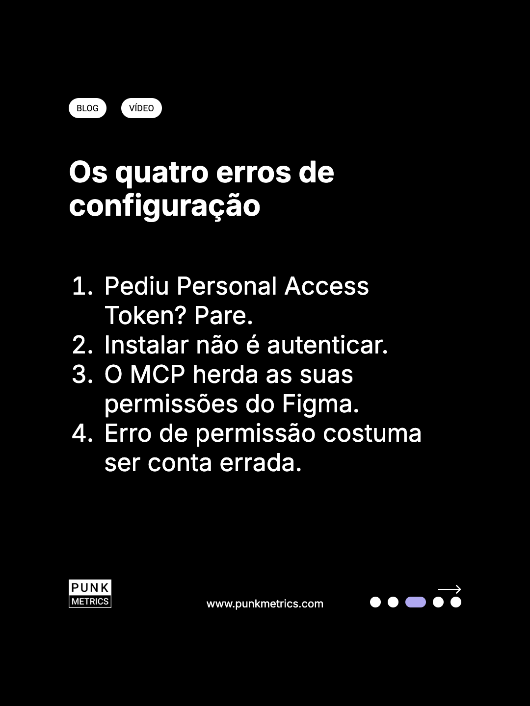
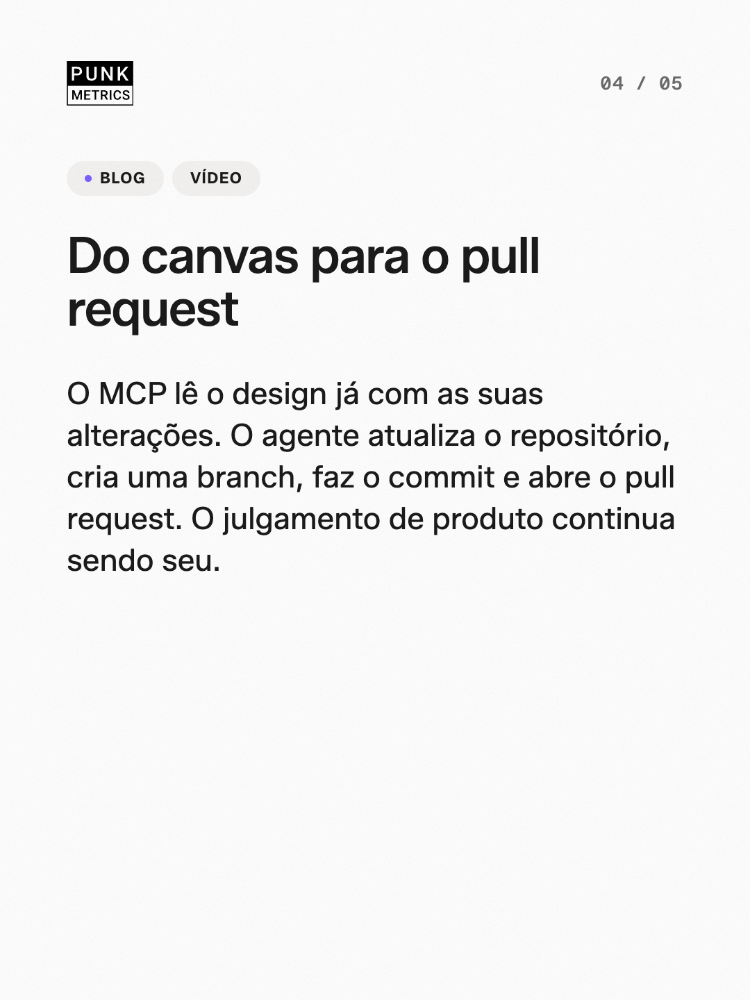
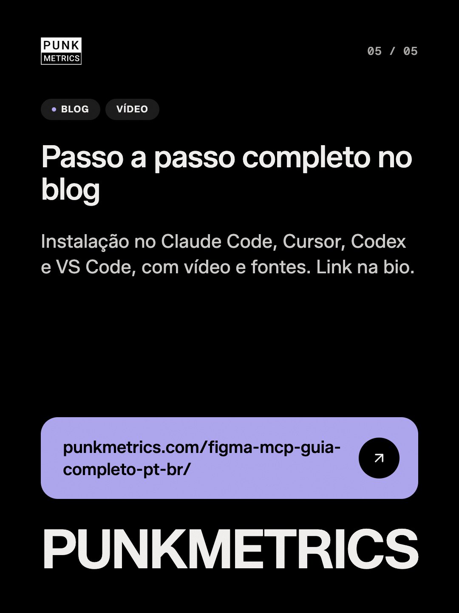

# ig-post

Plugin do Claude Code que transforma um post de blog WordPress num carrossel
de Instagram: 3 a 5 imagens 1080x1440 e a legenda, no template punk-dark da
PunkMetrics. Você passa a URL do post, o Claude escreve o deck respeitando o
espaço de cada slide, mostra o preview para aprovação e só depois gera os
PNGs.

<p>
  
  
  
  
  
</p>

Exemplo gerado a partir do post
[Figma MCP Guia Completo em PT-BR](https://punkmetrics.com/figma-mcp-guia-completo-pt-br/).
O deck e a legenda estão em `examples/figma-mcp-guia-completo-pt-br/`.

## Pré-requisitos

- [Claude Code](https://claude.com/claude-code)
- Node 20 ou mais novo
- Google Chrome ou Chromium instalado (o render usa o navegador da máquina,
  sem baixar outro)

## Instalação

Dentro do Claude Code:

```
/plugin marketplace add huxleydias/ig-post
/plugin install ig-post@punkmetrics
```

Na primeira execução o plugin instala as próprias dependências e confere se
acha o Chrome.

## Uso

```
/ig-post https://seublog.com/slug-do-post/
```

O fluxo:

1. Busca o post pelo REST público do WordPress (título, seções, categoria,
   tags).
2. Escreve o `deck.json` dentro do orçamento de texto de cada slide e
   confere com o `check` até tudo caber.
3. Abre o preview no navegador e para, esperando sua aprovação. Ajuste de
   texto acontece aqui, sem gerar imagem.
4. Aprovado, renderiza os PNGs e a legenda.

Tudo fica em `./ig-post/<slug>/`, na pasta onde você abriu o Claude Code:

| Arquivo | O que é |
|---|---|
| `extract.json` | o post estruturado |
| `deck.json` | o texto de cada slide, a legenda e as hashtags |
| `01.png` a `05.png` | os slides |
| `caption.md` | legenda pronta para colar |

A publicação no Instagram é manual. O plugin não posta nada.

## Como o orçamento de texto funciona

O corpo do slide é Inter 50px numa coluna de 771px. Cabe bem menos texto do
que parece, e parágrafo de blog colado no slide sempre estoura. Por isso cada
bloco tem um teto medido no template real: título até ~59 caracteres, corpo
de slide de texto até ~191, corpo da capa até ~103.

O `check` roda em duas passagens. A primeira estima linhas pelo número de
caracteres e roda em milissegundos. A segunda renderiza o slide de verdade e
mede cada bloco, e é ela que decide. Se algo estoura, o `check` diz qual
campo e quantos caracteres cortar, e o Claude reescreve até passar. O
template nunca é ajustado para caber o texto.

## Limitações

- **Só WordPress com REST público.** O plugin acha a API sozinho, inclusive
  em blog instalado em subpasta. Site que não é WordPress, ou que bloqueia o
  `/wp-json`, recebe uma mensagem explicando o que foi tentado.
- **Permalinks amigáveis.** URLs no formato `?p=123` não são suportadas.
- **Marca PunkMetrics fixa.** Logo e rodapé `www.punkmetrics.com` fazem
  parte do template. Veja `NOTICE.md`.
- **Logos de ferramenta.** A capa só usa os logos que existem em
  `templates/punk-dark/logos/`. Para incluir outro, abra um pull request.
- **Abreviação de categoria.** Categorias do seu blog que não estão em
  `config/abreviacoes.json` geram uma sugestão. Para fixar a sua, crie
  `./ig-post/abreviacoes.json` no formato
  `{ "Nome da categoria": "SIGLA" }`.

## Atualização

```
/plugin marketplace update punkmetrics
```

O setup reinstala as dependências sozinho depois de uma atualização.

## Problemas comuns

- **"Chrome ou Chromium não encontrado"**: instale o Chrome ou aponte o
  executável com a variável `CHROME_PATH`, por exemplo
  `CHROME_PATH=/usr/bin/chromium`.
- **"O WordPress deste site bloqueia o REST público"**: o blog desligou o
  `/wp-json` para visitantes. Sem ele o plugin não tem de onde ler o post.
- **Porta 5210 ocupada**: o preview sobe na próxima porta livre e o Claude
  usa a URL certa. Nada a fazer.

## Desenvolvimento

```
npm install
npm test
```

O que mantém o visual do template (Figma, medição de logos, recálculo dos
orçamentos) está em `maintainer/README.md`.

## Créditos

Criado por Huxley Dias na [PunkMetrics](https://punkmetrics.com). Código sob
licença MIT. Marca, fontes e logos de terceiros seguem o `NOTICE.md`.
